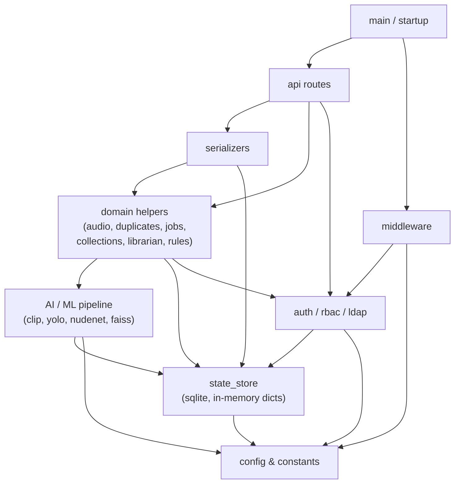

# Architecture Spine — TeleSaved AI

## Design Paradigm

**Layered monolith transitioning to a modular monolith.**

The codebase is a single aiohttp Python process divided into named logical sections. The transition
moves those sections into real Python modules under a `telesaved/` package — one module per
logical boundary — while leaving the runtime topology (one process, one SQLite database, one port)
unchanged. This is not a microservices decomposition; it is a namespace discipline applied
incrementally.

The layers, from innermost to outermost:

```
Config & constants      ← no imports from higher layers
Core state & DB         ← depends on config only
Domain helpers          ← depend on state + config; no HTTP
AI / ML pipeline        ← depends on domain helpers; no HTTP
Serializers             ← depends on domain helpers; no HTTP
API route handlers      ← depend on serializers + domain helpers; own HTTP
Middleware              ← depends on auth/config; wraps route layer
Main / startup          ← assembles all layers; run once
```

No module in a lower layer may import from a higher layer.

## Invariants & Rules

### AD-1 — Shared mutable state is owned exclusively by `state_store`

- **Binds:** all modules
- **Prevents:** any module mutating `tags`, `scores_store`, `embeddings_store`, `metadata_store`,
  `state_ids`, or `state_hashes` directly via global assignment from outside `telesaved/state.py`
- **Rule:** These six dicts and two sets are the canonical library index. All reads and writes
  go through functions defined in `telesaved/state.py`. No other module holds a persistent
  reference to the raw dicts. Pass them as arguments into functions that need them; do not
  re-import the raw globals.

### AD-2 — Module dependency direction

- **Binds:** all modules
- **Prevents:** lower-layer modules importing from higher-layer modules (e.g. a domain helper
  importing a route handler)
- **Rule:** Imports must only flow downward (outer → inner). The allowed dependency graph is:



### AD-3 — No module writes SQLite directly except `telesaved/state.py`

- **Binds:** all modules
- **Prevents:** raw `sqlite3.connect()` calls scattered across modules, bypassing the write lock
- **Rule:** `sqlite_lock` and all `sqlite3` calls live in `telesaved/state.py`. Other modules
  call `state.persist()` or the typed mutator functions — never `sqlite3` directly. This is the
  prerequisite for the future SQLite write queue and Postgres migration path.

### AD-4 — ML models are loaded once at startup, accessed via module-level singletons [ADOPTED]

- **Binds:** `telesaved/pipeline.py` (AI/ML layer)
- **Prevents:** models being reloaded per-request, or model references leaking into route handlers
- **Rule:** `clip_model`, `preprocess`, `yolo_model`, `_nudenet_detector`, `device`, and
  `text_tokens` are module-level singletons in `telesaved/pipeline.py`. Route handlers and
  domain helpers call pipeline functions — they never reference model objects directly.

### AD-5 — HTTP concerns are confined to route handlers and middleware [ADOPTED]

- **Binds:** all modules below the route layer
- **Prevents:** `web.Request`, `web.Response`, or aiohttp-specific types appearing in domain
  helpers, serializers, or state functions
- **Rule:** Functions below the route layer accept and return plain Python types (dicts, lists,
  strings, None). The route handler owns request parsing and response construction.

### AD-6 — `telesaved/` modules are imported into `app.py`; `app.py` is not imported by modules

- **Binds:** all modules
- **Prevents:** circular imports as modules are extracted
- **Rule:** During the transition, `app.py` is the composition root. It imports from
  `telesaved.*`. No `telesaved.*` module imports from `app.py`. Globals that a module needs
  are passed in at startup (dependency injection by argument), not imported from `app.py`.

### AD-7 — Serializers are pure functions; they receive data, return dicts, have no side effects

- **Binds:** `telesaved/serializers.py`
- **Prevents:** serializers triggering DB writes, job creation, or file system side effects
- **Rule:** All functions in `telesaved/serializers.py` are deterministic, take explicit
  arguments, and return plain dicts or lists. No `global` keyword, no `save_state()` calls,
  no I/O.

## Consistency Conventions

| Concern | Convention |
| --- | --- |
| Module filenames | `telesaved/{logical_name}.py` — snake_case, one section per file |
| Function names | snake_case throughout; route handlers prefixed `api_` |
| Error shapes | All API errors: `{"ok": false, "error": "<string>"}` with appropriate HTTP status |
| HTTP status codes | 400 bad input · 401 unauthenticated · 403 forbidden · 404 not found · 409 conflict · 500 server error |
| Logging | `logger = logging.getLogger("telesaved")` in every module; never `print()` |
| Date/time format | `datetime.now().isoformat(timespec="seconds")` for stored timestamps; ISO 8601 strings in API responses |
| Path representation | Relative paths (relative to `BASE_PATH`) everywhere in state; absolute paths resolved at the boundary via `safe_abs_path()` / `safe_join()` only in route handlers and file-system helpers |
| State mutation | Call `state.save()` (or the relevant typed mutator) after any write; never rely on implicit flush |
| Config access | Read from `cfg` dict at startup; never re-read `config.json` inside a request handler |
| Async vs sync | Route handlers are `async def`; domain helpers and pipeline functions are sync (called via `asyncio.get_event_loop().run_in_executor` for blocking work) |

## Stack

| Name | Version |
| --- | --- |
| Python | 3.10+ |
| aiohttp | ≥ 3.9 |
| Telethon | ≥ 1.36 |
| SQLite | stdlib (WAL mode, schema v3) |
| PyTorch | CPU build (CUDA optional) |
| CLIP | openai/CLIP @ git HEAD |
| Ultralytics (YOLOv8) | ≥ 8.0 |
| NudeNet | ≥ 3.4 |
| FAISS | faiss-cpu ≥ 1.8 (in-memory, no disk persistence yet) |
| Whisper | openai-whisper ≥ 20231117 (invoked as subprocess CLI) |
| ldap3 | ≥ 2.9 (optional, graceful fallback) |
| React | 18.3.1 (CDN, SRI-pinned) |
| Babel Standalone | 8.0.4 (CDN, SRI-pinned) |

## Structural Seed

Current (single file):
```text
telesaved-ai/
  app.py                  # 11,500-line monolith — all sections
  frontend/
    index.html            # React SPA (Babel in-browser transpile)
  requirements.txt
  ARCHITECTURE.md         # this document
  docs/
  systemd/
  scripts/
  dist/
```

Target (modular monolith — reached incrementally):
```text
telesaved-ai/
  app.py                  # composition root only — imports + main()
  telesaved/
    __init__.py
    config.py             # CONFIG + LOGGING sections
    state.py              # SQLITE STATE BACKEND + STATE globals + save/load
    auth.py               # LOCAL USERS / RBAC / SOURCE ACL + AUTH ROUTES
    ldap_backend.py       # LDAP IDENTITY BACKEND          ← Tier 1 extraction
    privacy.py            # PRIVACY / PIN LOCK
    jobs.py               # JOB / QUEUE CONTROL
    pipeline.py           # MODEL SETUP + NUDENET + FRAME + PREVIEW + SCENE + EMBEDDING + TAGGING
    faiss_index.py        # FAISS + SEARCH
    audio.py              # AUDIO INTELLIGENCE HELPERS     ← Tier 1 extraction
    serializers.py        # SERIALIZERS                    ← Tier 1 extraction
    librarian.py          # AI LIBRARIAN
    duplicates.py         # DUPLICATE DETECTION HELPERS
    cleanup.py            # SMART CLEANUP ASSISTANT HELPERS
    collections.py        # SMART COLLECTION HELPERS
    sources.py            # VIDEO SOURCE HELPERS + DOWNLOAD / INGEST
    trash.py              # TRASH HELPERS
    backup.py             # BACKUP HELPERS
    helpers.py            # HELPERS (pure utilities — format, path, hash)
    routes/
      library.py          # library + search + item API routes
      admin.py            # admin + tag + scoring + duplicate routes
      audio_routes.py     # audio analysis + transcript routes
      setup.py            # setup wizard + install check routes
      connectivity.py     # limp mode + connectivity routes
  frontend/
    index.html
  requirements.txt
  ARCHITECTURE.md
```

The transition is **additive and non-breaking**: each extraction moves a section from `app.py`
into its module, `app.py` gains an import, and the running application is unchanged. Modules
are extracted in dependency order — leaves first, roots last.

## Extraction Order (Tier 1 — immediate, low risk)

These three sections have the cleanest boundaries and move first:

1. **`telesaved/serializers.py`** — Pure functions, no global writes, no I/O. Depends only on
   domain helper functions already in `app.py` (called by reference). Zero regression risk.

2. **`telesaved/ldap_backend.py`** — Reads `auth_data` (passed as argument) and optional
   `ldap3` import. No state writes. 519 lines removed from `app.py`.

3. **`telesaved/audio.py`** — Reads and writes `metadata_store` (passed as argument to key
   functions). The Whisper subprocess call is self-contained. 952 lines removed from `app.py`.

Total after Tier 1: `app.py` shrinks from ~11,500 to ~9,000 lines.

## Deferred

- **`telesaved/state.py` / StateStore class** — The highest-leverage refactor. Requires
  touching every call site of `metadata_store`, `tags`, `scores_store`, etc. Needs its own
  design session before implementation. Prerequisite for Postgres migration path.
- **`telesaved/pipeline.py`** — ML model singletons. Straightforward extraction but blocked
  on `state.py` being clean first (pipeline writes to `metadata_store`).
- **`telesaved/routes/`** — Route handler split. Low complexity gain until domain helpers
  are fully extracted; deferred to Tier 3.
- **FAISS disk persistence** — Checkpoint on shutdown, read on startup. Lives in
  `telesaved/faiss_index.py` once extracted. Roadmap item P2 #1.
- **Async job worker + write queue** — Proper async SQLite writes via a queue. Roadmap P2 #8.
- **Frontend build step** — Replace CDN Babel with a real build (Vite/esbuild). Removes
  `unsafe-eval` requirement and enables true CSP. Roadmap P2 #3.
